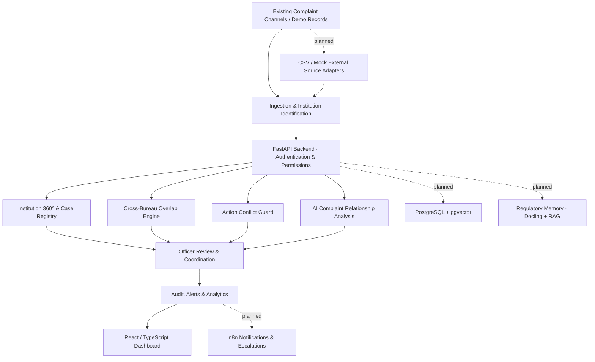

# AICTE Case360+

**Intelligent Cross-Bureau Complaint Monitoring & Regulatory Action Coordination**  
**Smart India Hackathon | Problem Statement ID: 26264**

> **Prototype notice:** Case360+ is a hackathon demonstration solution and is not an official AICTE service. Institutions, complaints, users, and cases shown in sample data are fictional.

## Problem Statement

**Integrated Dashboard for Monitoring and Tracking Institution-Related Complaint Cases Across AICTE Bureaus/Cells**

Institution-related grievances may be examined by different AICTE bureaus and cells. When information is handled separately, administrators may lack a unified view of ongoing proceedings for the same institution. This can lead to parallel investigations, repeated requests, conflicting proposed actions, and slower coordination.

Case360+ addresses this coordination challenge without replacing existing grievance-submission systems or taking regulatory decisions away from authorized officers.

## Our Solution

**One Institution. One Unified View. Smarter Coordination.**

Case360+ brings together institution records, complaints, regulatory cases, bureau ownership, proposed actions, and review history in a consolidated workspace. The system combines deterministic overlap checks with an extensible AI relationship-analysis pipeline to help officers understand where coordination may be needed.

### Core Capabilities

| Module | Purpose |
| --- | --- |
| **Institution 360°** | Consolidated view of complaints, active cases, involved bureaus, timelines, and alerts. |
| **Cross-Bureau Overlap Detection** | Identifies concurrent cases associated with the same verified institution. |
| **Action Conflict Guard** | Checks proposed inspections, notices, and document requests for potential overlap with existing actions. |
| **Coordination Workspace** | Helps authorized officers review related proceedings and record coordination decisions. |
| **AI Relationship Intelligence** | Uses institution identity and semantic complaint similarity to propose potentially related records for human review. |
| **Alerts, Analytics & Audit** | Supports deadline awareness, operational reporting, and traceability of administrative decisions. |

### What Makes Case360+ Different?

**Institution-first intelligence.** Complaints and regulatory cases are organized around a verified institutional identity instead of being viewed only as isolated tickets.

**Action Conflict Guard.** The system looks beyond duplicate complaints and evaluates potential overlap between regulatory *actions*. For example, if two bureaus propose similar inspections concerning the same institution and subject, an officer can examine the warning before proceeding.

**Explainable relationship suggestions.** Complaint comparison considers institutional identity, text meaning, and supporting category information. Similarity is an investigative aid, not proof that two complaints are duplicates.

**Human-in-the-loop governance.** Suggestions and warnings support review; the platform does not autonomously merge complaints, close cases, transfer jurisdiction, or issue regulatory orders.

## System Architecture

The diagram shows the **overall solution design**. Planned extensions are marked explicitly.



## AI Complaint Relationship Pipeline

1. **Identify the institution:** prefer verified Permanent IDs; use RapidFuzz for name-based candidate suggestions when identity is uncertain.
2. **Prepare complaint text:** normalize descriptions without discarding meaningful dates, amounts, or negations.
3. **Generate semantic representations:** use `intfloat/multilingual-e5-small` through Sentence Transformers (384-dimensional embeddings).
4. **Rank potential relationships:** compare complaint embeddings and apply institution, category, and bureau context rules.
5. **Explain and review:** present ranked suggestions for an authorized officer to approve or dismiss.

**Implementation note:** The AI workflow above describes the intended end-to-end feature. Check the current source code and running application to confirm which stages are enabled in this repository revision.

## Action Conflict Guard

```text
Officer proposes a regulatory action
                 |
                 v
      Compare existing actions
      (institution, subject, type,
          status, time window)
                 |
        +--------+--------+
        |                 |
   No conflict       Potential conflict
        |                 |
        v                 v
  Normal workflow   Explanation & severity
                          |
                          v
                  Authorized officer review
                          |
                          v
                    Decision + audit
```

This is a **coordination safeguard**, not an automatic statutory decision-maker. Any override or resolution should follow configured role permissions and retain its rationale.

## Technology Stack

| Layer | Technology |
| --- | --- |
| Frontend | React, TypeScript, Vite, Tailwind CSS, Recharts |
| Backend | Python, FastAPI, SQLAlchemy, Pydantic |
| Authentication | JWT and role-based access control |
| Development database | SQLite |
| AI/NLP architecture | RapidFuzz, PyTorch, Sentence Transformers, multilingual E5-small |
| Target vector storage | PostgreSQL + pgvector |
| Planned automation | n8n |
| Planned document intelligence | Docling + retrieval-augmented generation (RAG) |

## Roadmap

| Area | Scope |
| --- | --- |
| Foundation | Institution registry, complaint/case views, permissions, reporting |
| Action Conflict Guard | Action-level checks, warnings, authorized review and audit |
| AI Relationship Intelligence | Institution matching, semantic comparison, suggestions and review |
| UI/UX Transformation | Royal-blue design system, responsive layouts, interaction polish |
| External Data Integration | CSV ingestion and mock adapters with source-ID preservation |
| n8n Coordination | Officer notifications, reminders, escalation, periodic briefings |
| Regulatory Memory | Historical document parsing, secure retrieval, cited AI assistance |
| Final Validation | End-to-end testing, security review, demo and deployment checks |

**Status guidance:** Features described under the roadmap are development scope, not a claim that every integration is deployed. Review the repository's code, tests, and demo for the current working feature set.

## Getting Started

### Requirements

- Python 3.11 (recommended)
- Node.js and npm
- Git

### 1. Clone and configure

```bash
git clone <YOUR_REPOSITORY_URL>
cd <YOUR_REPOSITORY_DIRECTORY>
```

Configure environment variables using the example configuration provided by the repository, if present. Do not commit `.env` files or credentials.

### 2. Start the backend

From the repository root:

```bash
python -m venv venv
# Activate the virtual environment for your operating system
pip install -r backend/requirements.txt
python scripts/seed_demo_data.py
python -m uvicorn backend.app.main:app --reload
```

Backend API: `http://127.0.0.1:8000`  
Interactive API docs: `http://127.0.0.1:8000/docs`

> If the current branch provides additional ML requirements or database migration commands, follow those files before starting the relevant features.

### 3. Start the frontend

Open a second terminal:

```bash
cd frontend
npm install
npm run dev
```

Open the local URL shown by Vite (typically `http://localhost:5173`).

### 4. Run checks

```bash
python -m pytest backend/tests/ -v
```

From `frontend/`:

```bash
npx tsc -b
npm run build
```

## Prototype Demo Walkthrough

1. **Sign in:** use a fictional demonstration account configured in the seed data.
2. **Open Institution 360°:** inspect cases, complaints, and bureau involvement for one institution.
3. **Explore overlaps:** view potentially related proceedings across bureaus.
4. **Try Action Conflict Guard:** propose a fictional inspection or document request and examine the warning and rationale.
5. **Review coordination:** show officer or supervisor actions supported by the current build.
6. **Explore AI matching:** if enabled, compare complaint descriptions and review suggested links.
7. **View the audit trail:** show the decisions that the application records.

For integrations still under development, present the **architecture and intended workflow** rather than claiming a live execution.

## Security & Governance

- Authenticated, role-aware access to administrative workflows.
- Institution identity checks before same-institution relationship recommendations.
- Original complaint and case records remain independently traceable.
- Officer decisions are distinct from algorithmic suggestions.
- Demonstration data is fictional and should not contain confidential grievance records.


**AICTE Case360+ — One Institution. One Unified View. Smarter Coordination.**
